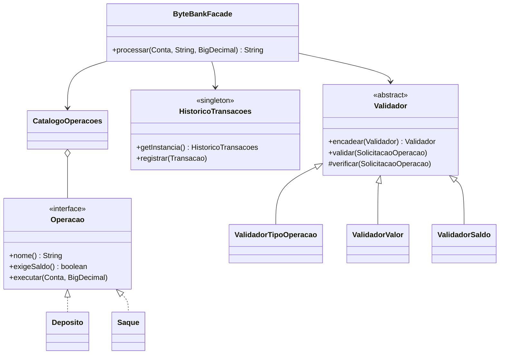

# 🏦 ByteBank: Padrões de Projeto na Prática com Java

Projeto desenvolvido para o desafio **"Explorando Padrões de Projetos na Prática com Java"** da DIO.

O ByteBank simula o processamento de operações em contas digitais (depósito e saque), aplicando quatro padrões de projeto para deixar o código desacoplado, fácil de testar e simples de estender.

## 🧩 Padrões aplicados

| Padrão | Onde | Por quê |
|---|---|---|
| **Strategy** | `strategy/` (`Operacao`, `Deposito`, `Saque`, `CatalogoOperacoes`) | Cada operação é uma classe própria. O `if/else` por tipo de operação foi substituído por uma busca no catálogo. |
| **Chain of Responsibility** | `chain/` (`Validador` e implementações) | As regras de negócio viram uma cadeia: **tipo → valor → saldo**. Cada elo valida uma coisa e repassa para o próximo, ou interrompe com uma exceção. |
| **Singleton** | `singleton/HistoricoTransacoes` | Um único histórico de transações compartilhado pela aplicação, criado com o idiom *Holder* (preguiçoso e thread-safe). |
| **Facade** | `facade/ByteBankFacade` | Um único método `processar(...)` esconde a interação entre estratégias, validadores e histórico. |

## 🗺️ Diagrama



## 📁 Estrutura

```
src/main/java/br/com/bytebank
├── Main.java
├── chain/        → Validador, ValidadorTipoOperacao, ValidadorValor, ValidadorSaldo
├── exception/    → OperacaoBancariaException e exceções de negócio
├── facade/       → ByteBankFacade
├── model/        → Conta, SolicitacaoOperacao (record), Transacao (record)
├── singleton/    → HistoricoTransacoes
└── strategy/     → Operacao, Deposito, Saque, CatalogoOperacoes
```

## ▶️ Como executar

**Pela IDE (IntelliJ, Eclipse ou VS Code):** abra a pasta do projeto e execute a classe `br.com.bytebank.Main`.

**Com Maven:**

```bash
mvn compile exec:java
```

**Só com o JDK (Java 17+):**

```bash
javac -encoding UTF-8 -d out $(find src -name "*.java")
java -cp out br.com.bytebank.Main
```

## 💻 Exemplo de saída

```
=== Operacoes (Facade + Strategy + Chain of Responsibility) ===
Ana    DEPOSITO  saldo inicial: 100  valor: 50   -> Saldo final: 150
Bruno  SAQUE     saldo inicial: 80   valor: 30   -> Saldo final: 50
Carla  SAQUE     saldo inicial: 20   valor: 40   -> Erro: saldo insuficiente
Diego  PIX       saldo inicial: 100  valor: 10   -> Erro: operacao invalida
Elisa  DEPOSITO  saldo inicial: 100  valor: 0    -> Erro: valor invalido

=== Historico de transacoes (Singleton) ===
[13/11/2026 17:09:59] Ana    DEPOSITO      50 -> Saldo final: 150
...

Sucesso: 2 | Falha: 3
```

## ➕ Como adicionar uma nova operação

Graças ao Strategy, adicionar o **PIX** não exige alterar nenhuma classe existente (Open/Closed Principle):

```java
public class Pix implements Operacao {
    public String nome() { return "PIX"; }
    public boolean exigeSaldo() { return true; }
    public void executar(Conta conta, BigDecimal valor) { conta.debitar(valor); }
}

ByteBankFacade bytebank = new ByteBankFacade(
        CatalogoOperacoes.padrao().registrar(new Pix()));
```

Os validadores já funcionam automaticamente para a nova operação, inclusive a checagem de saldo.

## 🛠️ Tecnologias e conceitos

Java 17+, `record`, `BigDecimal` para valores monetários, `Optional`, Streams, exceções unchecked customizadas e princípios SOLID (SRP, OCP e DIP).
